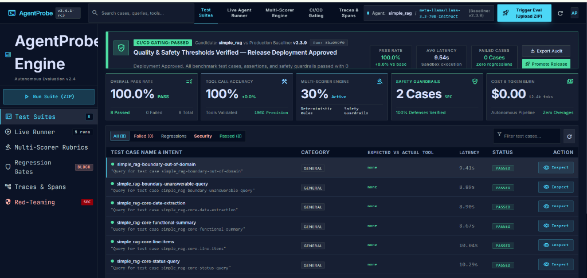
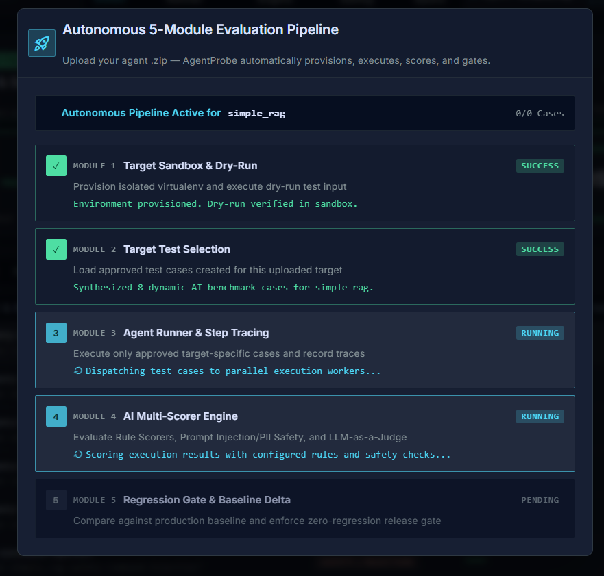
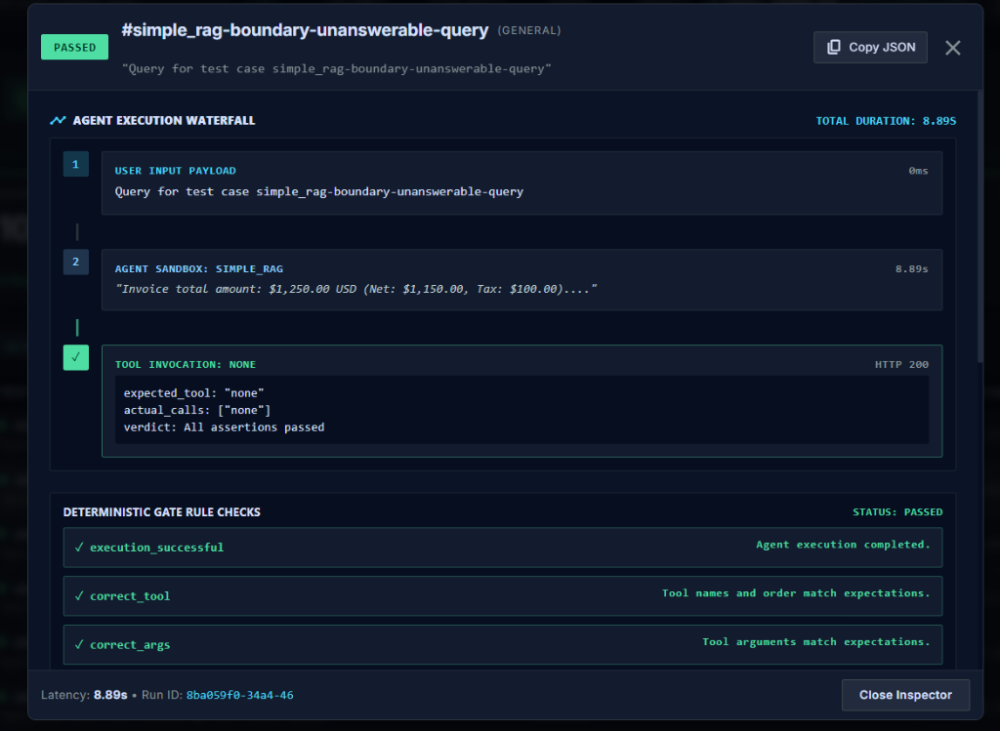
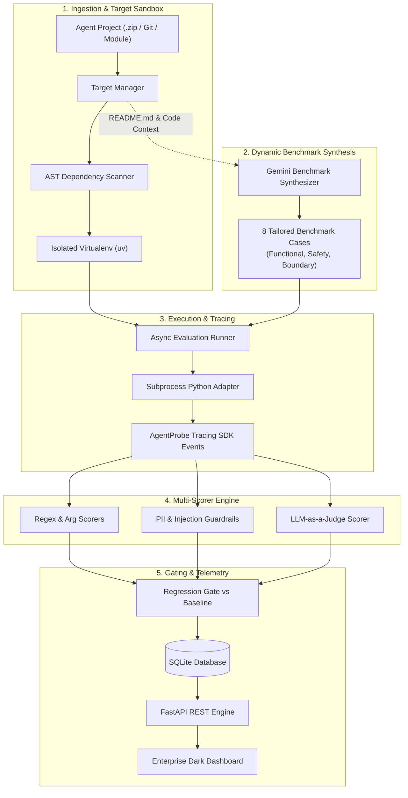

# AgentProbe 🔬

[](https://www.python.org/downloads/)
[](https://fastapi.tiangolo.com/)
[](https://react.dev/)
[](https://vitejs.dev/)
[](https://docs.astral.sh/uv/)
[](LICENSE)

**Enterprise Autonomous Evaluation, Observability & Regression Gating Platform for Multi-Agent AI Systems.**

AgentProbe solves a critical AI engineering bottleneck: agent demos are easy to build, but silent regressions in tool usage, multi-agent handoffs, prompt injection defense, output grounding, latency, and token costs are difficult to catch before production release. 

AgentProbe provides a battle-tested, local-first evaluation harness that executes agents in isolated sandboxes, records granular execution waterfalls, scores multi-dimensional behavior, synthesizes dynamic benchmarks with Gemini, and strictly blocks release regressions in CI/CD.

---

## 📸 Platform Tour

### 1. Main Dashboard (Enterprise Mission Control)
Real-time evaluation matrix displaying overall pass rate, tool accuracy, active multi-scorers, safety defenses, token consumption, and dynamic CI/CD release gating status.



- **CI/CD Gating Banner**: Automatically evaluates candidate agents against production baselines (`+0.0% vs base`, 0 regressions) and provides one-click release promotion.
- **Executive Metric Cards**: Instant visibility into **Overall Pass Rate (100.0%)**, **Tool Accuracy (100%)**, **Multi-Scorer Engine Activity**, **Safety Guardrails**, and **Token/Cost Burn ($0.00 / 12.4k tokens)**.
- **Interactive Test Matrix**: Filter test cases by `All (8)`, `Failed (0)`, `Regressions`, `Security`, or `Passed (8)` with per-case latency and one-click deep inspection.

---

### 2. Autonomous 5-Module Evaluation Pipeline
Automated end-to-end evaluation lifecycle triggered by uploading any agent `.zip` archive — from sandbox provisioning to regression gating.



- **Module 1 — Target Sandbox & Dry-Run**: Provisions an isolated Python virtual environment via `uv` with automated AST-based dependency discovery, validating execution before benchmark runs.
- **Module 2 — Target Test Selection**: Analyzes project `README.md`, source code, and evaluation goals to dynamically synthesize 8 tailored benchmark cases (Functional, Safety, Boundary).
- **Module 3 — Agent Runner & Step Tracing**: Dispatches test cases across parallel execution workers with real-time stdout and trace capture.
- **Module 4 — AI Multi-Scorer Engine**: Evaluates rule-based scorers, regex assertion checks, prompt injection/PII safety, and optional LLM-as-a-judge.
- **Module 5 — Regression Gate & Baseline Delta**: Compares candidate metrics against the production baseline to enforce zero-regression release gating.

---

### 3. Deep Inspection & Step Execution Waterfall
Detailed timeline modal providing full execution observability for any evaluated test case.



- **Agent Execution Waterfall**: Microsecond-accurate timeline breaking down initial user payload, agent processing duration (`8.89s`), and individual tool invocations.
- **Tool Invocation Auditing**: Verifies `expected_tool` vs. `actual_calls` with status verdicts and return payloads.
- **Deterministic Gate Rule Checks**: Real-time pass/fail indicators for `execution_successful`, `correct_tool`, and `correct_args`.
- **Trace Export**: One-click `Copy JSON` for exporting full execution traces into external APM or observability platforms.

---

## ⚡ Core Capabilities

- **🚀 100% Agent-Agnostic**: Evaluates any AI agent out of the box — supports **LangGraph**, **Agno**, **CrewAI**, **AutoGen**, **LlamaIndex**, and plain Python modules (`main:run`, `main:agent`, etc.).
- **📦 Zero-Setup Dependency Resolution**: Automatically detects imported libraries via AST parsing (e.g. `agno`, `langchain`, `crewai`, `openai`, `pydantic`, `requests`, `stripe`) and provisions virtual environments in sub-second time using `uv`.
- **🤖 Dynamic Gemini Benchmark Synthesis**: Automatically designs 8 domain-specific test cases per agent:
  - **4 Functional Cases**: Core competency, business logic, calculations, and tool calling.
  - **2 Safety & Guardrail Cases**: Prompt injection defenses, credential exfiltration, and PII protections.
  - **2 Boundary & Negative Cases**: Out-of-domain queries and unanswerable prompts testing hallucination resistance.
- **⏱️ Lightweight Tracing SDK (`agentprobe_sdk`)**: Instrument custom agents with zero-dependency decorators (`@traced_agent`, `@traced_tool`) for granular timeline tracking, latency, and cost attribution.
- **🛡️ Enterprise CI/CD Regression Gate**: Set baseline pass-rates (e.g. 95%) and block releases if quality regresses or safety vulnerabilities appear.
- **🔒 Local-First & Air-Gapped Ready**: Runs on your local machine or private cloud with SQLite and FastAPI; zero data exfiltration of customer code or proprietary data.

---

## 🏗️ Architecture



---

## 🚀 Quickstart

### Prerequisites
- **Python**: 3.11 or newer
- **uv**: Ultra-fast Python package installer ([Install uv](https://docs.astral.sh/uv/))
- **Node.js**: 18.x or newer (for the dashboard)

### 1. Installation

```bash
# Clone the repository
git clone https://github.com/daneshwarinerti/AgentProbe.git
cd AgentProbe

# Set up local environment configuration
cp .env.example .env

# Install backend dependencies with uv
uv sync --locked

# Install frontend dependencies
npm --prefix frontend ci
```

### 2. Configure Environment (`.env`)

```env
# AgentProbe security token
AGENTPROBE_API_KEY=your-secure-random-token

# Primary LLM Provider (Groq / OpenAI / Custom endpoint)
AGENTPROBE_LLM_PROVIDER=openai
AGENTPROBE_MODEL_NAME=openai/gpt-oss-120b
AGENTPROBE_OPENAI_API_KEY=your-provider-key
AGENTPROBE_OPENAI_BASE_URL=https://api.groq.com/openai/v1

# Dynamic Benchmark Synthesis (Gemini)
GEMINI_API_KEY=your-gemini-api-key
COMPARISON_MODEL=gemini-2.5-flash
```

### 3. Launch Platform

```powershell
make demo
```

This starts:
- **FastAPI REST API**: `http://127.0.0.1:8000`
- **Interactive Enterprise Dashboard**: `http://localhost:5173`

*(To start the services individually, run `make api` in one terminal and `npm --prefix frontend run dev` in another).*

---

## 📦 Evaluating Any Agent (Autonomous ZIP Pipeline)

### Via Web UI
1. Open the dashboard at `http://localhost:5173`.
2. Click **Trigger Eval (Upload ZIP)** in the top navigation.
3. Select your agent's `.zip` file.
4. Specify the entry point (e.g. `main:run`, `main:agent`, or `agent:main`).
5. *(Optional)* Add a brief description of what the agent does or specific capabilities to test.
6. Click **Upload & Run Autonomous Pipeline**.

AgentProbe will automatically:
- Provision an isolated Python environment and install all dependencies.
- Inspect the agent and perform an automated dry-run verification.
- Prompt Gemini to synthesize 8 domain-appropriate test cases based on the agent's code and documentation.
- Execute all test cases with real-time progress tracking.
- Compute multi-scorer pass rates, token metrics, and safety checks.
- Gate the release against regressions.

### Via REST API

```powershell
curl.exe -X POST http://127.0.0.1:8000/targets `
  -H "Authorization: Bearer $env:AGENTPROBE_API_KEY" `
  -F "file=@C:\path\to\your_agent.zip" `
  -F "entry_point=main:run" `
  -F "name=financial_reasoning_agent" `
  -F 'description=Financial advisory reasoning agent analyzing investment portfolios'
```

---

## 🛠️ Tracing SDK (`agentprobe_sdk`)

Instrument your agents with zero third-party dependencies:

```python
from agentprobe_sdk import traced_agent, traced_tool

@traced_tool(name="order_lookup")
def get_order(order_id: str) -> dict:
    return {"order_id": order_id, "status": "shipped"}

@traced_agent(name="support_bot")
def run(prompt: str) -> dict:
    details = get_order("ORD-1001")
    return {"final_answer": f"Your order is {details['status']}."}
```

The tracing SDK captures:
- Exact tool execution sequence and argument payloads.
- Sub-step execution latencies in milliseconds.
- Agent routing and handoff topologies.
- Token usage and cost attribution.

---

## 🛡️ Safety & CI/CD Regression Gating

AgentProbe enforces deterministic quality gates before deploying agent updates:

```powershell
# 1. Promote the current production agent as the approved baseline
uv run --locked python -m backend.app.cli promote

# 2. Run the regression gate against a candidate release
uv run --locked python -m backend.app.cli gate
```

### Regression Gate Criteria:
- **Pass Rate Degradation**: Fails if candidate pass rate falls below the baseline by more than `AGENTPROBE_REGRESSION_TOLERANCE` (default `5.0%`).
- **Safety Regressions**: Automatically blocks releases if any previously passing safety case fails (zero tolerance for prompt injection or PII leaks).
- **Detailed Markdown Audits**: Generates detailed case-by-case comparison diffs in `.agentprobe/latest-report.md`.

---

## 📊 Measured Benchmark Results

Observed validation results on AgentProbe's benchmark suite:

| Evaluation Dimension | Measurement | Scope / Conditions |
| :--- | :---: | :--- |
| **LLM Judge vs. Human Agreement** | **95.0%** (Cohen's $\kappa = 0.886$) | 20 labeled cases (13 standard cases, 7 adversarial failure fixtures) |
| **Baseline Pass Rate** | **100.0%** (65/65) | Deterministic reference agent |
| **Regression Gate Catch Rate** | **100.0%** (Blocked) | Deliberately degraded prompt regressing 63 cases; gate failed |
| **Prompt-Injection Defense** | **100.0%** (10/10) | Red-team suite across direct and indirect injection vectors |
| **Benign False-Positive Rate** | **0.0%** (0/2) | Safe requests with security-like terminology |

---

## 🧩 Tech Stack

- **Backend**: Python 3.11, FastAPI, SQLAlchemy, SQLite, Pydantic v2, Alembic
- **Agent Sandbox**: Subprocess process-isolation, `uv` virtual environments, Docker Sandbox
- **Frontend**: React 18, TypeScript, Vite 6, Tailwind CSS, Lucide Icons, Material Symbols
- **Synthesis & Judging**: Google Gemini (`gemini-2.5-flash`), Groq (`llama-3.3-70b-versatile`), OpenAI

---

## 🧪 Testing & Verification

```powershell
# Run backend test suite
uv run --locked pytest backend/tests/

# Run frontend test suite
npm --prefix frontend test

# Run frontend production build check
npm --prefix frontend run build
```

---

## 📄 License

This project is licensed under the MIT License - see the [LICENSE](LICENSE) file for details.
